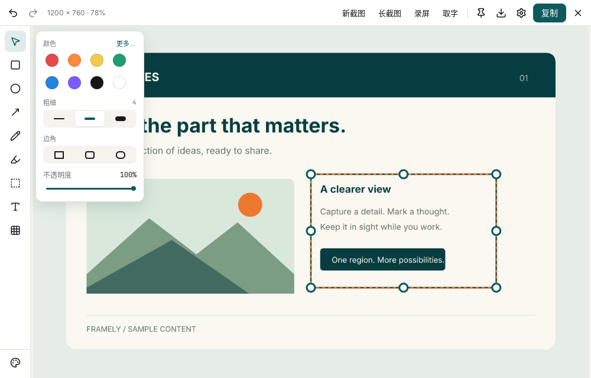

# Framely · 取景

[Framely](https://github.com/wildalley/framely) is an open-source screenshot,
annotation and image pinning app for Windows, Linux and macOS. Its windows
use MyGo's native UI, with no web frontend. This directory points to the
complete app in its own repository.



The app stays in the system tray. A global shortcut opens a region picker;
the selection can be copied, saved, annotated or pinned above other windows.
It also records a region, recognizes text offline and translates it.
Scrolling screenshots are supported on Windows and Linux. Screen recording
currently captures video without audio.

## What to read in the source

- [Desktop lifecycle](https://github.com/wildalley/framely/tree/main/internal/desktop):
  tray menus, global shortcuts, single-instance activation, independent image
  windows and background tasks dispatched back to the main thread.
- [Region picker and editor](https://github.com/wildalley/framely/tree/main/internal/editor):
  native UI views, an adjustable selection overlay, annotations, pinned
  windows, clipboard image writes and headless view tests.
- [Capture](https://github.com/wildalley/framely/tree/main/internal/capture):
  platform capture and Linux desktop portal integration, alongside MyGo's
  window and desktop APIs.

## Run or build

Download a complete package from
[GitHub Releases](https://github.com/wildalley/framely/releases/latest), or
clone the app separately with Go 1.27.3 or later:

```sh
git clone https://github.com/wildalley/framely.git
cd framely
go test ./internal/...
go run ./cmd/framely
```

Capture, media and offline OCR use companion components. For a complete
build, follow the app's [build instructions](https://github.com/wildalley/framely#开发与构建),
including their platform dependencies; `go run` alone does not build those
components. Runtime packages include the components, while offline
translation models are downloaded separately in settings.

Framely is licensed under MIT.
